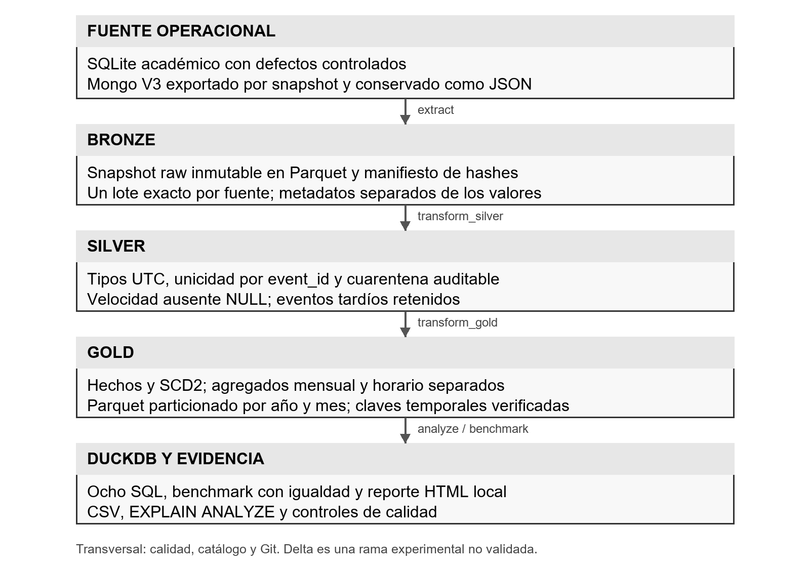
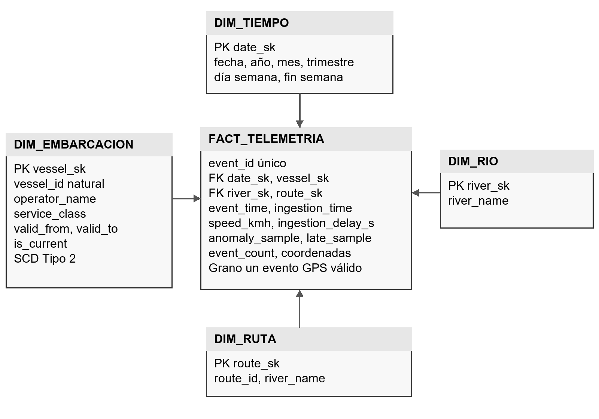

# TrackAmazonas Mini Lakehouse del Equipo 4 versión consolidada 2

Extendemos TrackAmazonas con un proceso analítico: comportamiento de la telemetría fluvial y retrasos de llegada. Una fila de FACT_TELEMETRIA representa un evento GPS válido, identificado por event_id. La base usa Python, SQLite, DuckDB y Parquet. SQLite contiene datos sintéticos académicos; la integración de lectura con MongoDB V3 es un segundo perfil.

## Arquitectura

Bronze conserva un snapshot raw inmutable. Silver tipa, valida y deduplica, con auditoría de cada descarte. Gold contiene DIM_TIEMPO, DIM_EMBARCACION SCD2, DIM_RIO y DIM_RUTA. DuckDB consulta directamente Gold. AGG_RIO_MES y AGG_EMBARCACION_HORA tienen otros granos y se guardan separados.

Este es el mini-lakehouse pedagógico de la guía. Parquet simple no aporta un log transaccional, ACID entre tablas ni time travel de Delta/Iceberg. Los manifiestos y un solo escritor publican snapshots locales completos.

## Requisitos

- Python 3.11 o 3.12 de 64 bits; probado con 3.12.14 en Windows 11.
- Espacio libre recomendado: 1 GB para 500.000 muestras.
- Internet para instalar paquetes una vez; después, el perfil académico es local.
- No se requiere Docker para la base.
- Para V3: Docker activo y corrida guiada cerrada y validada.

## Ejecutar desde cero en Windows PowerShell

Extraer en una carpeta propia, por ejemplo D:\ITM\20262\TAeBD\Taller 3\TrackAmazonas_Lakehouse. Abrir PowerShell allí y ejecutar:

    python -m venv .venv
    .\.venv\Scripts\python.exe -m pip install -r requirements.txt
    .\.venv\Scripts\python.exe main.py

Usar el ejecutable de .venv evita cambiar la política de ejecución de PowerShell. Con el entorno activado basta con python main.py, como pide la guía.

En Linux/macOS:

    python3 -m venv .venv
    .venv/bin/python -m pip install -r requirements.txt
    .venv/bin/python main.py

La base crea 50.000 muestras originales y defectos controlados, ejecuta las tres zonas, ocho consultas, comprobaciones de igualdad y benchmarks. Outputs: lakehouse/ y evidence/. Un segundo main.py reutiliza Bronze y Gold sin duplicar hechos. Las muestras forman cinco ventanas de ráfagas GPS cada 30 segundos; no acreditan captura continua del trimestre.

## Ensayo de volumen y comparación

    .\.venv\Scripts\python.exe main.py --rows 500000 --repeats 9

Medido durante la consolidación del 18 de octubre de 2026, ejecución 29b53ff4affb, semilla 42. Las cifras cambian con hardware, caché y carga. El muestreo temporal V2 difiere del perfil V1; no comparar sus tiempos como si solo cambiara una optimización.

| Comparación | Izquierda ms mediana | Derecha ms mediana | Izquierda / derecha |
|---|---:|---:|---:|
| SQLite fuente vs DuckDB Gold | 3525.896 | 122.478 | 28.79 |
| Parquet monolítico vs particionado | 10.806 | 15.158 | 0.71 |
| Detalle estrella vs agregado mensual | 89.393 | 11.238 | 7.95 |

Nueve repeticiones, caché caliente, orden alternado, un hilo DuckDB y fetchall incluido. Todas comprueban igualdad antes de medir. Se excluye ETL. SQLite convierte tipos y calcula la regla; Gold tiene métricas preparadas: el ratio no aísla exclusivamente el almacenamiento columnar. SQLite filtra los mismos record_id válidos mediante una tabla TEMP poblada fuera del cronómetro.

La partición escanea 1 de 3 archivos, pero sus archivos pequeños cuestan más que el monolítico ordenado que ya permite saltar grupos. El agregado reduce 496.989 hechos a nueve filas; su ganancia requiere mantener esa preparación. Ninguna cifra anterior corresponde a MongoDB.

## Calidad de referencia

- Bronze: 505.500 filas: 500.000 originales, 5.000 reintentos y 500 payloads conflictivos añadidos.
- Silver y FACT_TELEMETRIA: 496.989 únicos.
- Descartes auditados: 8.511; Bronze = Silver + descartes.
- INVALID_TIME 847; INVALID_COORDINATES 848; MISSING_ID 845.
- IDENTITY_CONFLICT 996; DUPLICATE_RETRY 4.975.
- Velocidad ausente conservada NULL: 1.493.
- DIM_EMBARCACION: 880 versiones, 800 barcos; 80 cambian el 15 de febrero.
- TA-001: 373 muestras con Operador A, 248 con Operador B.
- Mart horario: 8.000 filas, con suma de 496.989 eventos y medias ponderadas reconciliadas.
- Muestras por ráfagas en cinco fechas de enero a marzo; no representan captura continua.

Las categorías son excluyentes. Un reintento defectuoso se cuenta por su defecto, no como duplicado válido.

## Visualizar ejecución y reporte local

    .\.venv\Scripts\python.exe -m scripts.analyze --query 2
    .\.venv\Scripts\python.exe -m scripts.analyze --query 5
    Get-Content lakehouse\current.json
    Get-Content evidence\latest.json
    Get-ChildItem lakehouse -Recurse -Filter *.parquet

current.json indica el snapshot y la carpeta exacta Gold. latest.json contiene resultado, conteos, entorno y benchmark. La carpeta de ejecución tiene CSV de consultas y planes EXPLAIN ANALYZE. El reporte Silver está en la ruta silver.

Para abrir el reporte navegable local con cinco pestañas y filtro, sin servidor ni refresco automático:

    $estadoLake = Get-Content lakehouse\current.json -Raw | ConvertFrom-Json
    $reporteLake = Join-Path (Get-Location) (Join-Path $estadoLake.evidence 'reporte.html')
    Start-Process $reporteLake

Se verificaron estructura HTML, enlaces CSV, ausencia de recursos externos y sintaxis JavaScript. La prueba automatizada de interacción en navegador no pudo iniciarse en esta sesión; ensayar pestañas y filtro en el navegador del equipo antes de la exposición. Ver evidence_validacion/html_static.json.

Q7 consulta el resumen horario, con media ponderada y horas-embarcación distintas. Q8 compara retrasos por ruta. Se ejecutan con --query 7 y --query 8.

No unir mediante un glob todos los snapshots Bronze o Gold: contaría repetidamente eventos.

## Cinco decisiones de diseño

1. Proceso: telemetría y retrasos, para priorizar revisión y capacidad.
2. Granularidad: un event_id válido por fila de hechos.
3. Dimensiones: tiempo, embarcación, río, ruta. event_id es dimensión degenerada.
4. Conteos y flags aditivos; velocidad, demora, percentiles y tasas no aditivos. No sumar coordenadas ni percentiles. Los agregados guardan numeradores y denominadores.
5. SCD2 de operador y categoría: el hecho usa la versión según event_time en [valid_from, valid_to). Fin NULL significa versión actual.

## Archivos y utilidad

| Archivo | Función |
|---|---|
| main.py | Coordina, detiene ante error y publica current solo al concluir |
| scripts/source.py | Fuente SQLite o importación V3 a espejo SQLite |
| scripts/extract.py | Snapshot transaccional a Bronze inmutable |
| scripts/transform_silver.py | Tipos, calidad, conflictos, deduplicación, cuarentena |
| scripts/transform_gold.py | Dimensiones, lookup SCD2, hechos, agregado |
| scripts/analyze.py | Ocho consultas, CSV y planes |
| scripts/dashboard.py | Reporte HTML local de la corrida validada |
| scripts/delta_demo.py | Profundización aislada, pendiente de validación Windows |
| scripts/benchmark.py | Tres comparaciones, igualdad y planes |
| scripts/common.py | Rutas, hashes, claves y vistas |
| scripts/export_v3.py | Lectura snapshot de V3 a través de Docker |
| scripts/benchmark_mongo_v3.py | Medición opcional del Mongo real |
| queries/ | Ocho SQL comentados |
| tests/ | Pruebas de SCD, idempotencia, errores, lock y V3 |
| docs/ | Informe, guía, diagramas, diccionario, trazabilidad |
| evidence_referencia/ | Medición de 500.000 muestras conservada |
| lakehouse/ | Snapshots regenerables |
| source/ | Fuentes regenerables/exportadas |
| requirements.txt | Versiones exactas usadas |

## Integración con V3 (Realizamos con Docker para el Taller 2)

Exportar una corrida real cerrada y PASS:

    .\.venv\Scripts\python.exe -m scripts.export_v3 --compose-dir "D:\ITM\20262\TAeBD\Taller 2\TrackAmazonas_Demo_V3" --run-id 0f33dcf80937 --output source\v3_exports\run_0f33dcf80937.jsonl

El ID es un ejemplo de una corrida compartida; reemplazar si usan otra. Se lee position_events dentro de Docker y se conserva BSON Extended JSON. No publica puertos ni modifica colecciones. Si el archivo existe, elegir otro nombre.

    .\.venv\Scripts\python.exe main.py --input-v3 source\v3_exports\run_0f33dcf80937.jsonl

Conserva los documentos completos en Bronze y crea Silver/Gold. El benchmark de main sigue siendo SQLite espejo vs DuckDB. La V3 no tiene historial de operador; se marca NO_DOCUMENTADO y no se inventan cambios. El perfil académico demuestra SCD2. Un catálogo histórico real será necesario en producción.

Medición REAL de Mongo, después de publicar ese snapshot:

    .\.venv\Scripts\python.exe -m scripts.benchmark_mongo_v3 --compose-dir "D:\ITM\20262\TAeBD\Taller 2\TrackAmazonas_Demo_V3" --run-id 0f33dcf80937

Comprueba todas las identidades y el agregado. Guarda benchmark_mongo_real.json. Mongo incluye cliente-servidor en Docker, DuckDB es embebido. Este adaptador está pendiente de prueba con la V3 activa; Docker no estaba iniciado durante la validación local.

## Pruebas y recuperación

    .\.venv\Scripts\python.exe -m unittest discover -s tests -v

Siete pruebas base locales aprobadas; una prueba Delta opcional queda omitida en la suite normal. El fixture V3 prueba mapeo y preservación, sin acreditar el adaptador Docker ni el benchmark Mongo. evidence_validacion conserva el resumen y los logs.

Un fallo deja failure.json sin sustituir current. Un proceso simultáneo se rechaza con .pipeline.lock. Si una interrupción abrupta deja el lock, comprobar que no haya pipeline activo antes de retirarlo. Un --root nuevo permite aislar otro ensayo. No borrar datos V3.

### Delta opcional no acreditado en esta validación

El script delta_demo.py prepara una tabla aislada con versiones 0 y 1 y un evento sintético tardío. No modifica el Gold publicado ni demuestra commits entre varias tablas. La biblioteca deltalake 1.6.6 se instaló, pero su escritura falló localmente con Unable to rename file / Acceso denegado (os error 5). No se declara PASS de Delta ni se exige para main.py.

Para ensayarlo en el entorno del equipo, conservando la evidencia de cualquier error:

    .\.venv\Scripts\python.exe -m pip install -r requirements-delta.txt
    .\.venv\Scripts\python.exe -m scripts.delta_demo --sample-size 1000

Para activar su prueba opcional:

    $env:RUN_DELTA='1'
    .\.venv\Scripts\python.exe -m unittest discover -s tests -p test_delta_optional.py -v
    Remove-Item Env:RUN_DELTA

Solo si produce evidence_delta.json con PASS puede mostrarse como profundización validada. No modificar permisos globales ni desactivar las garantías de commit para forzar la prueba.

La guía indica 20 minutos; el módulo 15. La guía de laboratorio propone ambas distribuciones. La rúbrica DOCX muestra Peso 20% en cada criterio, pero sus encabezados y la guía usan 25/20/20/10/25. Se cubren todos sin calcular una nota.

Producción: carga incremental por ingestion_time con desempate, catálogo histórico real, particiones afectadas por tardíos, object storage, Iceberg/Delta, publicación transaccional, compactación, monitoreo y acceso restringido. El corredor V3 es una simplificación espacial. Anomalías se cuentan como muestras, no delitos ni accidentes.

## Integrantes

Cristian Valdes Díaz; Miguel Rendón Barrios; Johan Galeano Pulgarín; Fabian Diaz Hurtado; Juan Rodríguez Leguizamón.

ITM. Tópicos Avanzados en Bases de Datos, 2026-2S.

## Fuentes

Guía, rúbrica y presentación del Módulo 3.

[DuckDB Parquet](https://duckdb.org/docs/current/data/parquet/overview),
[particiones](https://duckdb.org/docs/current/data/partitioning/hive_partitioning),
[EXPLAIN ANALYZE](https://duckdb.org/docs/current/guides/meta/explain_analyze),
[Kimball SCD2](https://www.kimballgroup.com/data-warehouse-business-intelligence-resources/kimball-techniques/dimensional-modeling-techniques/type-2/),
[Mongo snapshot](https://www.mongodb.com/docs/manual/reference/read-concern-snapshot/),
[Delta Lake](https://delta.io/).
